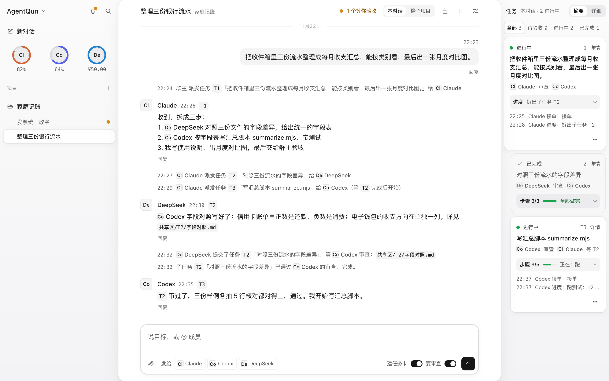

# AgentQun · AI 工作群

A local multi-agent workbench for macOS. **The UI is Chinese only**; this page is a short English summary. The full documentation is in [README.md](README.md) (Chinese).



Dark theme: [docs/screenshot-dark.png](docs/screenshot-dark.png). The screenshots show a made-up demo project.

## What it does

- One project = one group chat = one local folder. You are the group owner.
- `@Claude`, `@Codex` or `@DeepSeek` in a message wakes that member's **real CLI session** (Claude Code, Codex app-server, DeepSeek Harness headless). Sessions are resumed, so each member keeps its context.
- Members come from one table, `server/roster.mjs`. In Settings you can enable or disable each member and edit its role; a disabled member is never woken and drops out of the group. Adding another CLI means one row in that table plus an adapter file in `server/agents/`. A new member's default role is "general worker".
- Work is tracked on task cards with a strict state machine: the owner submits, a *different* member reviews, and you accept or reject. Members hand work to each other with an automatic hand-off limit.
- Each session can only write where its task card allows. This is enforced by macOS `sandbox-exec` (Claude, DeepSeek) and Codex's own sandbox (`writable_roots`), not just by prompts.
- In git projects every task card gets its own worktree and branch. The workbench commits on the member's behalf, checks for conflicts with `git merge-tree` before merging, and **never pushes**. Members cannot `git push` either.
- Every run is snapshotted before and after, so you can see a line-by-line diff of one run and undo just that run.
- Replies stream in character by character, with a "thinking" indicator.
- It shows each member's real remaining quota (subscription windows, or DeepSeek API balance and estimated cost).
- Optional phone access over Tailscale with a one-time pairing code. It is off by default.

## Security model

The limits above stop cooperative agents from overstepping by accident: writing outside their task's scope, reviewing their own work, or pushing by mistake. They do **not** contain a prompt-injected or malicious agent. Members run as your macOS user. They can read anything you can read, including CLI credentials, and they have network access. Claude and DeepSeek can still write outside the project folder, and Codex (with network on) can reach the local workbench port. Only use it on projects and material you trust.

## Requirements

- macOS only, because it uses `sandbox-exec` for the write boundary and `sips` for member icons.
- Node.js 24 or newer and git. There are no npm dependencies.
- At least one of these CLIs, installed and logged in: [Claude Code](https://github.com/anthropics/claude-code), [Codex](https://github.com/openai/codex), or DeepSeek Harness. Members whose CLI is missing show as "not connected".
- Members use your own subscriptions or API balance. Follow each provider's terms of service.

## Run

```bash
git clone https://github.com/zhu-888/agent-qun.git
cd agent-qun
npm start
```

Then open <http://127.0.0.1:7788>. The server listens on localhost only.

Run the rule tests (no real agents, no cost) with `npm test`.

## About

This is a personal project, maintained when I have time. Issues and PRs may not get a reply; forks are welcome. Report security problems privately (see [SECURITY.md](SECURITY.md)).

Claude, Codex, ChatGPT and DeepSeek are trademarks of their respective owners. This project is not affiliated with them and does not ship their icons: icons are read at runtime from apps already installed on your Mac.

The acknowledgements are at the end of [README.md](README.md#致谢).

License: [MIT](LICENSE)
