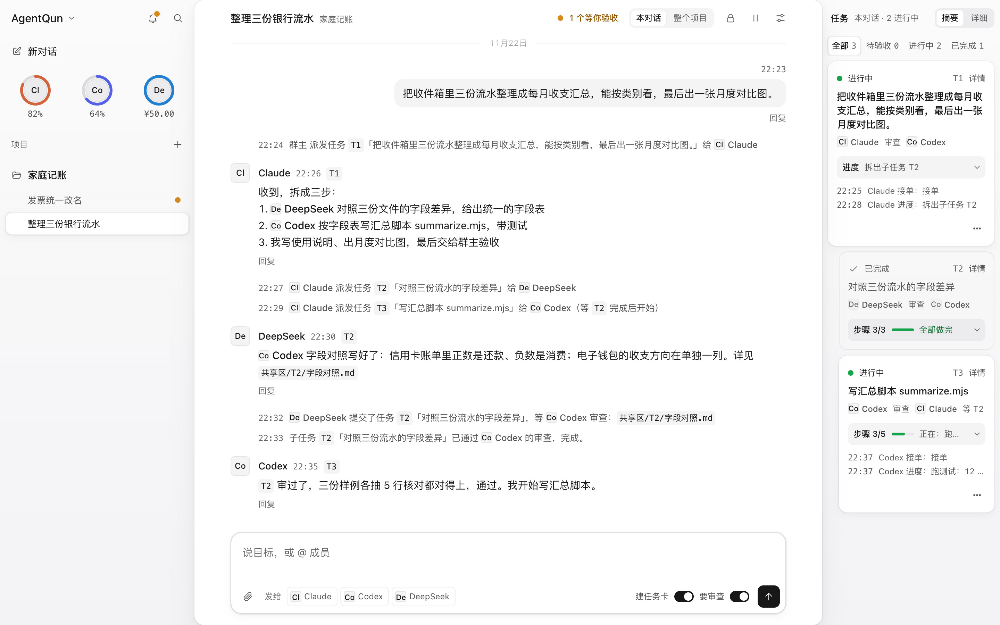

# AgentQun · AI 工作群

在你自己 Mac 上运行的中文多 Agent 工作台。一个项目就是一个工作群，对应一个本地文件夹。你是群主：@ 谁，谁的**真实命令行会话**就被唤醒去干活；只说目标不点名时，由 @Claude 接下来拆任务。成员之间自己交接、互相审查，最后把成果交到右侧任务卡上等你验收。

[English](README.en.md)（界面只有中文）



夜间的样子见 [docs/screenshot-dark.png](docs/screenshot-dark.png)。截图里是一个虚构的演示项目。

## 需要什么

- **只支持 macOS。** 写入边界靠 macOS 自带的 `sandbox-exec`，成员图标靠自带的 `sips` 从应用里取。
- **Node.js 24 或更新的版本**，以及 **git**（git 项目的任务卡工作区、改动快照都要用）。
- **至少装好并登录一家命令行**：[Claude Code](https://github.com/anthropics/claude-code)、[Codex](https://github.com/openai/codex)、DeepSeek Harness，哪家没装，那位成员就显示“未连接”，别的照常用。
- 成员用的是你自己的订阅额度或 API 余额，工作台不另收费，也不接触你的登录凭据。用各家命令行和接口时，请遵守它们各自的服务条款。

## 启动

```bash
git clone https://github.com/zhu-888/agent-qun.git
cd agent-qun
npm start
```

浏览器打开 <http://127.0.0.1:7788>。以后也可以直接双击文件夹里的 `启动工作台.command`，它会自动打开浏览器。

不需要 `npm install`：工作台只用了 Node.js 自带的模块。需要 Node.js 24 或更新的版本。

工作台只监听本机（127.0.0.1），别的电脑访问不到。

## 安全：防手滑，不防恶意

成员是在你自己电脑上、以你的系统用户身份运行的真实命令行。工作台加的限制，是为了让正常干活的成员不越界、不互相踩、不误推：

- 每个会话只能写这张卡的范围，别的会话的文件、收件箱、项目里的其它位置都只读（系统沙箱强制）；
- 交接、提交、审查都走 `qun`，工作台按“这是哪一次运行”认人，负责人审不了自己的卡，也冒充不了群主；
- Claude、DeepSeek 连不上工作台自己的端口，绕不过 `qun` 去调群主用的接口；
- 成员不能 `git push`；工作台自己跑 git 时不信工作区里能被成员改的 `.git` 文件。

这些**挡不住一个被提示注入、存心作恶的成员**。做不到的地方：

- 成员能读你电脑上它读得到的所有文件，包括各家命令行的登录凭据，而且能联网；
- Claude、DeepSeek 只在项目文件夹里受写入限制，项目外面（比如家目录里的配置文件）照样能写；
- Codex 打开了联网，它的命令能连到本机的工作台端口；
- 不能推送只防误推，存心绕开挡不住（见下面“写入边界”）。

所以：只在你信任的项目和材料上用。来历不明的文件放进收件箱、让成员读不可信的网页或仓库，都可能让它被带歪。工作台本身只监听本机（127.0.0.1）；别的网页发不出带工作台标记的请求，也不能用 iframe 把工作台嵌进去诱导你点按钮。“用默认应用打开”遇到 `.command`、`.app`、带执行权限的文件这类打开就会运行的东西，只在访达里显示，不替你运行。

## 成员和接入方式

出厂有三位成员：

| 成员 | 分工 | 真实接入 | 运行中插话 | 计费 |
|---|---|---|---|---|
| @Claude | 协调员、干活主力：方案、界面、文档、实现和审查 | Claude Code 命令行，流式输入：`claude -p --input-format stream-json`，用 `--resume` 接着上次的会话 | 支持 | Claude 订阅 |
| @Codex | 工程负责人：自动化脚本、转换程序、接入和测试 | Codex 命令行的 `codex app-server`，用 `thread/resume` 接着上次的会话；沙箱限制它只能写项目文件夹。app-server 起不来时自动退回 `codex exec`（那时不能插话） | 支持 | ChatGPT 订阅 |
| @DeepSeek | 逆向与兼容性分析：文件格式和版本差异 | DeepSeek Harness 无界面模式：`dsh --profile headless --json`，用 `--session-id` 接着上次的会话 | 不支持 | DeepSeek API，按量付费 |

接入前提：

- **Claude**：命令行要登录过一次。工作台会自动找到 `claude` 命令（包括 Claude 桌面 app 自带的那份）。没登录时左栏会显示登录命令。
- **Codex**：`codex login` 登录过。
- **DeepSeek**：装了 DeepSeek Harness，并且在它的模型设置里填过 API key。工作台启动 DeepSeek 时把这把 key 放进它的进程环境里，不写日志、不写进项目、不显示。在“设置 → 成员”里把 DeepSeek 停用，就等于收回这个许可：工作台连它的 key 都不会去读。

哪位成员没接通，左栏就显示“未连接”和原因，@ 它时群里会明说“没有送达”，不会由别的模型顶替。

### 启用、停用和改分工

“设置”最上面是成员表，对所有项目生效：

- **启用 / 停用**：停用的成员不会被唤醒，也不出现在成员栏、@ 按钮和成员看到的群成员名单里。你 @ 它时群里会说“已停用”。它手上还没做完的任务卡会停着，群里马上提醒你一次；你可以改派、取消，或者重新打开它，打开后它接着做。至少要留一位启用。
- **协调员**：没点名的需求由 @Claude 接。Claude 停用时，由表里第一位启用的成员接，它会收到协调员的说明。
- **改分工**：每位成员有两段分工。“一句话分工”是协调员派活时看的，群里和成员栏也显示它；“详细分工”是写给那位成员自己看的工作说明。改完点“保存”，下一次唤醒就用新的。“恢复出厂分工”可以改回去。
- 你的选择存在 `data/settings.json` 的 `members` 里，只存和出厂不一样的部分。

### 加一位新成员

成员表在 `server/roster.mjs`，一位成员一行：名字、接入方式、分工、颜色、图标从哪个应用取、收费方式、默认开几个会话、它自己的密钥变量名。不写分工的新成员默认是“通用干活”。要接另一家命令行：

1. 在 `server/roster.mjs` 里加一行。
2. 在 `server/agents/` 里写它的接入文件（照 `claude.mjs`、`codex.mjs`、`deepseek.mjs` 的样子），再在 `server/main.mjs` 的 `ADAPTER_MODULES` 里登记。
3. 想让它能选模型：在 `server/models.mjs` 的 `BUILTIN` 里列出模型，在 `server/members.mjs` 的 `DEFAULT_TIERS` 里写三档默认用哪个。
4. 想看到它的额度：在 `server/quota.mjs` 里加一个读额度的办法。不加的话显示“暂不可获取”。

别处不写死成员名字：点名的别名、头像、颜色、审查人顺序、提示词里的成员名单都从这张表来。

## 怎么用

1. **建项目**：点左栏“项目”两个字右边的“＋”，填名字，可以选一个已有的文件夹。工作台会在里面建：
   - `收件箱/`：你放文件的地方。放进去后群里出现一次通知，同一个文件不会重复通知。
   - `共享区/`：成员之间交接需求、样例和成果。
   - `成员/Claude/`、`成员/Codex/`、`成员/DeepSeek/`：各自的工作目录（只给启用的成员建）。
   - `.workgroup/`：这个项目的群聊和任务记录、每次运行的日志。
2. **派活**：点左栏的“新对话”（或项目右边的小笔），在输入框里说目标。输入框右下角有两个开关：“建任务卡”和“要审查”，默认都开着。每提一个需求就是这个项目里的一个对话，列在项目下面。`@Codex 写个脚本…` 就是点名，被点名的人接单；不点名由 @Claude 接。默认会建一张任务卡，取消勾选“建任务卡”就只是说句话。
3. **看进度**：
   - 每条消息下面显示送达状态：已入队 → 已送达（真实会话已启动）→ 已接单（成员已经开始动作）。
   - 成员正在干活时 @ 它（不建任务卡的那种消息）：消息直接写进它正在进行的会话，它读到后显示“已送到正在干活的 @某某”，并在同一次运行里一并处理。新任务和审查请求不插队，等它这一步结束再送。DeepSeek 不支持插话，会显示“已入队，等它这一步结束”。
   - 左栏上面是启用的成员的图标：外面一圈是额度还剩多少，在干活时右下角亮绿灯。点图标能看到它开着几个会话、每个会话在做哪张任务卡、正在跑什么命令、用的哪个模型。
   - 右栏任务卡显示状态和步骤进度：“步骤 2/5”加一条进度条，后面写着现在在做什么；点一下展开，能看到每一步是几点开始的、哪几步已经做完。下面是最近两条过程、成果文件和审查意见。
4. **验收**：任务到“待群主验收”时卡片会高亮。点成果文件直接打开（CSV 会显示成表格），然后点“验收通过”或“打回”。打回要写原因，成员会收到并重做。
5. **随时干预**：暂停整个项目、暂停某位成员接活、停止正在跑的运行、把任务改派给别人、取消任务。

## 界面

三栏的“派工看板”。白天是白色的：界面本身只用一条石墨灰色阶，没有渐变、发光、毛玻璃，颜色留给内容。夜间是“夜班的调度室”：深蓝的底，角上透一点蓝光，灯和额度圈会发光，主操作和选中的那一项是蓝色，每位成员的名字各有一色（颜色写在成员表里）。两种外观里颜色的含义一样：成员各有一色，绿是在干活，琥珀是在等你，红是停了。

- **好几层，颜色靠得很近**：窗口的底、中间的聊天面板、右栏的任务卡、弹出的菜单各是一层，颜色只差一点点，靠几层很淡的影子分开，不靠硬线。聊天内容、项目列表、任务卡滚到上下边缘时是慢慢淡出的。
- **状态灯**：全界面用同一盏小圆灯。灰色是没事，绿色是在干活（只有真的有会话在跑时才会呼吸），琥珀色是在等你，红色是停了或被打回，空心是没接上。
- **成员图标**：出厂三位成员的头像是你电脑上这三个应用自带的图标（Claude、ChatGPT 里的 Codex、DeepSeek Harness）。凡是提到成员的地方都是“小图标 + 名字”：消息里的 @、送达回执、任务卡的负责人和审查人、输入框下面的“发给”。
- **琥珀色只表示“等你”**：“N 个等你验收”、任务卡上的“等你验收”、消息里的 @群主。主按钮（验收通过、发送、保存）白天是墨色，夜间是蓝色。

三栏分别是：

- **左：照 Codex 应用的样子。**
  - 最上面是“工作台”（点开有外观、重新检测成员）、铃铛（哪个项目有任务卡等你验收、哪个对话有新消息）和搜索。
  - “新对话”：在当前项目里开一个新对话。
  - 启用的成员的图标排成一行：图标裁成圆的、填满圈里面；外面一圈是额度还剩多少：灰色的底圈是一整圈，上面那段有颜色的弧是剩余的部分（取最紧的那个额度窗口；不到 20% 变琥珀色），每位成员用自己的颜色，下面写着数字；DeepSeek 是按量付费，没有百分比，有余额就画满，下面写的是余额。在干活时图标右下角亮绿灯。点图标弹出详情：状态、模型和推理强度（可以直接改）、每个额度窗口、这个项目跑了几次、正在跑的会话（可以单独停）；右上角“···”里有额度来源、消耗明细和“暂停接活”。
  - “项目”两个字右边的“＋”：新建项目。
  - 项目树：点项目名收起或展开。鼠标靠近一个项目，会出现它的文件夹路径（点一下修改）、“···”和“在这个项目里开新对话”。项目下面是它的对话，最近的在上面，默认列 5 个，点“显示更多”看全部；有任务卡等你验收的对话亮琥珀灯，正在干活的亮绿灯，有新消息的是一个实心圆点。对话右边的“···”可以改名、归档。
  - 项目的“···”：置顶、改名、修改路径、在访达中显示、放进分组（或新建分组）、全部标为已读、归档全部对话、从工作台移除。
- **中：当前对话。** 顶上一条写着现在看的是哪个对话、属于哪个项目，右边可以在“本对话”和“整个项目”之间切换（整个项目 = 这个项目里所有对话的消息和任务卡，加上收件箱通知和群摘要），再右边是暂停和设置。成员的话靠左平铺，一条一行：图标、名字、模型、时间，下面是正文。你自己（群主）的话靠右，垫一块浅灰底，不带头像和名字。新对话是一张空白页：启用的成员的图标、一句“在「项目名」里做什么？”，下面是输入框。系统通知是和正文对齐的一行小字；需要你处理的通知是一张带铃铛的小卡片。有成员在干活时，输入框上方会多出一行，写着谁、在做哪张卡、正在运行什么（或者正在想、正在说的最新几个字），右边可以停止；点这一行看它这次到目前的全部过程（见“看成员正在做什么”一节）。
- **聊天左边缘的一列短线。** 一条短线是你在群里说过的一句话，从上到下和聊天的先后一致。鼠标指上去会弹出那句话的预览（时间、@ 了谁、开头几行、它引出的任务卡做得怎么样），确认是它之后点一下，聊天直接跳到那条消息并亮一下。聊天滚到哪一句，那条短线就变长变深；引出的任务卡在等你验收的那句是琥珀色。只说过一句话时这列短线不出现。
- **右：任务卡（工单）。** 这一栏比较窄（256 像素）。看某个对话时只列这个对话引出的任务卡，看“整个项目”或新对话时列全部。每张卡的抬头是状态灯、状态和工单号，下面是标题、负责人和审查人，再下面是步骤进度那一行（“步骤 2/5”、进度条、现在在做什么；点开看每一步，做完的打勾，正在做的亮灯）。顶上可以切“摘要 / 详细”：摘要只留等你验收的成果、审查意见和最近两条过程；详细把交付物、写入范围、模型、过程记录全部摊开。每张卡也可以单独点“详情”。“验收通过”和“打回”是按钮；其余的操作（查看过程、跟进、改派、取消）都在右下角的“···”里。已完成的卡会淡下去。

几个操作习惯：

- **⌘K**（或点左栏顶上的放大镜）：搜项目、对话、任务卡、成员、文件，或者直接执行“新对话”“暂停项目”“设置”“生成群摘要”这类操作。方向键选，回车执行，Esc 关闭。
- **换项目**：在左栏点另一个项目下面的对话，就到了那个项目；点项目右边的小笔是在那个项目里开新对话。
- **外观**：点左上角的“工作台”，可以选跟随系统、浅色、深色，只影响当前这个浏览器。
- **文件**：聊天和任务卡里的文件点一下就能预览，表格文件按表格显示。
- **两侧栏的宽度可以自己调**：把鼠标放在左栏和中间、或中间和右栏的交界处，光标变成左右箭头，按住拖动。拖得比最窄还窄一截，那一栏就收起来，边上留一个小把手，点一下或往外拖就回来。双击交界处恢复默认宽度。调好的宽度记在浏览器里，下次打开还是这样。
- **窗口变窄时**：右栏先收成抽屉（点右上角的“任务”打开），再窄一些左栏也收成抽屉（点左上角的成员图标）。
- 弹出的面板、菜单和抽屉都可以按 Esc 或点旁边的空白处关闭。

系统设置里打开“减少动态效果”时，界面会停掉全部动画。

**这一版是怎么设计的。** 用的是 [unslop](https://github.com/heydamir/unslop) 这个设计 skill（作者 Damir Sokolovsky，CC BY 4.0）的流程：先对照它的清单找出“AI 味”，再从产品自己推出方向，然后按间距、颜色、图标、文案、字体、布局、细节、动效的顺序逐层改。定下的方向是：

| | |
|---|---|
| 产品 | 一个人在自己的 Mac 上给 Claude、Codex、DeepSeek 派活，看它们交接、互相检查，最后自己验收 |
| 性格 | 有条理、沉稳、利落 |
| 世界 | 车间的派工看板：工位、工单、呼叫灯 |
| 亮点 | 左栏的成员名册；等你验收的那张工单 |
| 标志 | 成员标记：小图标 + 名字 |

落到规矩上：间距都是 4 的倍数；字号只有 12、13、14 三级，字重只用 400 和 500；数字用等宽数字，金额统一两位小数；线条图标只有一套，大小 16、线宽 1.5；圆角按大小分级（小标签 4 到 6、按钮和输入框 8、卡片 12、面板 16）；动画只有一条缓动曲线。没有照搬 skill 的地方：字体仍用系统自带的（工作台只在本机运行、不联网取字体，中文也要靠系统字体）；顶栏高 48 而不是它建议的 56 到 64，为的是一屏看全。

**关于图标。** 成员的图标是各家公司的商标，不随项目发布。工作台启动时从你电脑上已经装好的应用里取出来（`/Applications/Claude.app`、`/Applications/ChatGPT.app` 里自带的 Codex 图标、`/Applications/DeepSeek Harness.app`），用 macOS 自带的 `sips` 缩成小图，存在 `data/icons/`，只在本机显示，用来认出是哪位成员。从哪个应用取写在成员表里（`server/roster.mjs` 的 `icon`）。没装那个应用的话，那位成员显示成两个字母的头像。界面上其余的线条图标都是自己画的。

## 项目和对话

- **一个项目 = 一个文件夹 = 一组成员的工作区。** 不同项目的聊天、任务卡、文件互不相通。
- **一个项目里可以有很多对话。** 你每提一个需求就是一个对话：从你那句话开始，到成员的回复、派出的任务卡、审查和验收，都在这个对话里。对话只属于它所在的项目。在一个对话里接着说，还是这个对话；回复某条消息、跟进某张任务卡，也留在原来的对话里。
- **同一个项目里，成员之间是通的。** 任务卡、共享区的文件、群摘要是整个项目共用的，所以在新对话里可以直接让成员接着用别的对话做出来的东西。
- **成员各自的会话。** 每张任务卡是一个独立的会话。不建任务卡的对话，每个对话也各用各的会话：在同一个对话里接着说，它记得前面说过什么；换一个对话就是新的会话，不会把别的对话里的闲聊带过来（任务卡、文件和群摘要它照样看得到）。换一个项目更是全新的。
- **成员自己那边的记录也是按项目分开的。** 成员都是从项目文件夹里启动的，它们各自的程序按文件夹存放会话记录：Claude Code 是 `~/.claude/projects/` 下每个项目文件夹一个目录，Codex 和 DeepSeek Harness 也按工作目录归档。所以在工作台里新建一个项目，每位成员那边就各自多出一个对应这个文件夹的项目；之后这个项目里的活，记录只会落在那里。
- **改项目文件夹的位置。** 鼠标靠近项目，点出现的路径（或“···”里的“修改路径”）。填一个还不存在的位置，工作台会把整个文件夹移过去；如果你已经在访达里把文件夹挪走了，填它现在的位置就行。有成员正在这个项目里干活时不能改。改完之后，成员各自的会话从头开始（它们的记录是跟着旧位置存的），聊天记录、任务卡和文件都还在。
- **从工作台移除项目**只是不再列出来，文件夹原样留着；以后用同一个文件夹新建项目，聊天记录和任务卡会回来。
- **已读、归档、置顶、分组**都只是工作台里的整理方式，不影响成员干活。升级前就有的老对话一律算已读。

## 省额度的几个做法

成员每做一步，都要把这个会话里前面的全部内容重读一遍。所以真正费额度的不是工作台发过去的那几百上千字，而是会话有多长、走了多少步、用的哪个模型。工作台在这几处帮着省：

- **每个对话一个会话。** 以前同一位成员在一个项目里共用一个“日常对话”会话，越用越长（有一次 Codex 连续七次的输入量是 15 万 → 19 万 → 40 万 → 46 万 → 76 万 → 148 万 → 188 万 token）。现在每个对话各用各的，新对话从头开始。
- **会话太长自动换新的。** 一个对话的会话接着用了 8 次，或者上一次运行重读了超过 40 万 token，下一次就换一个新会话（新会话会重新拿到群规、群摘要和这个对话最近的消息）。任务卡的会话做到一半换掉代价大，超过 150 万才换。DeepSeek 每一步自带的固定内容就很大，只按次数算。
- **只带有关的群聊。** 新会话带这个对话最近的 20 条消息和项目级的系统通知；接着聊时只带上一次运行之后新出现的消息，它自己说过的、触发这一次的那条都不重复。别的对话里的话不带。
- **闲聊用快速档。** 不建任务卡的对话按“闲聊”这一类选模型，默认是快速档（Claude 是 Sonnet 5.5 · medium，Codex 是 GPT-6-Astra · low）。想要更好的回答：在设置的“任务类型 → 模型档位”里把“闲聊”改成常规，或者点成员图标直接指定一个模型。任务卡不受影响。
- **小事可以不审查。** 输入框右下角的“要审查”默认是开的。关掉它，这张任务卡提交后直接到你验收，省掉审查那一整次运行；卡上会标明“没有经过成员审查”。只有你能关，成员自己派出去的子任务照常审查。
- **提醒成员少走几步。** 群规里多了一条：能一条命令做完的不要拆成很多步，文件一次读够，不要重复读、重复跑。对按量付费的 DeepSeek 说得更重：问一句就能答的不要动用工具。

DeepSeek 的花费主要看它那 26 万 token 的固定内容有没有命中缓存：命中时回一句话约 ¥0.007，没命中约 ¥0.26。命不命中取决于它上一次是多久以前用的，工作台管不了。

## 同一位成员并行

同一位成员可以同时开几个会话，各做各的任务卡。

- **每张任务卡一个会话**：成员是某张卡的负责人或审查人，这张卡就有它的一个专属会话，上下文只管这张卡。这张卡再来事（返工、汇总、你的跟进），接着这个会话做。不属于某张卡的 @ 走它的“日常对话”会话。
- **上限**：默认 @Claude 最多同时 3 个会话，@Codex 2 个，@DeepSeek 1 个（它按量付费，开多了花钱更快）。出厂值写在成员表里。在“设置”里改，每位成员 1 到 6 个。超过上限的排队，消息下面会显示“N 个并行会话都在忙，排队中”。
- **冲着某张卡说话**：点任务卡上的“跟进”，或者回复那张卡下面的消息，这句话就只送到正在做这张卡的会话；它正在干活的话直接插进去。
- **单独停止**：左栏和群聊下方的运行条里，每个正在跑的会话各有一个“停止”按钮。
- **文件**：几个会话不会同时改同一个文件，见后面的“写入边界”；git 项目里每张卡还有自己的工作区，见“git 项目”一节。

## 看成员正在做什么：逐字显示

成员干活时，输入框上方那一行跟着它走：

- **正在运行**：它正在跑的命令。
- **正在想**：它在思考，内容不显示。Claude 还会写“已经想了约 N token”，让你知道它没卡住。
- **正在说**：它正在写的话，边写边显示，只放最新的字；放不下时从左边截掉。
- **点这一行**：打开这次运行的全部过程（跑过的命令、工具结果、说过的话），最下面一段“正在写…”是它还没写完的那段话。面板开着时跟着刷新，停在最下面；它跑完后面板变成“完成”。

聊天区只放最终回复，不会边写边跳。

- **谁能逐字**：Claude 和 Codex 能逐字。DeepSeek Harness 的无界面模式一段话写完才整段给出，它就按整段刷新。
- **Claude 先想后说时是整段出来的**：Claude 跑完命令后常常先思考十几秒，想完以后整段回复在十几毫秒内一起到达（直接用 Claude 命令行也是这样，不是工作台截住了）。所以这时你会先看到“正在想”，然后一下子出现整段话。不先思考的回复（比如日常对话）是一个字一个字出来的。
- **不花额外 token**：只是换一种显示方式。推给界面时攒一下，最多每 0.15 秒一次。
- **为什么不是常驻进程**：Claude 每次干活还是新起一个进程，跑完退出。实测新起进程出第一个字要 2 到 3 秒，同一个进程接着聊要 1 秒，每次只差一两秒，也不省 token（缓存能留 1 小时）。一个空闲的 Claude 进程大约占 230 MB 内存，写入范围又是在进程启动时定死的，所以没有做常驻。运行中插话不受影响。

## 改动快照：看这一次改了什么，不满意就撤回

成员每次运行前后，工作台把这次运行能写的那几个目录各拍一次快照（只拍它能写的目录，所以同时在跑的别的会话不会混进来）。

- **在哪看**：成员回复下面有一行“改了 3 个文件 +12 −3”，点开是逐个文件的逐行对比。任务卡的 ··· 菜单（做完的卡在卡片底部）里有“查看改动”，列出这张卡每一次运行的改动。
- **撤回**：对比面板底部的“撤回这次改动”。只动这一次改过的文件：新加的删掉，改过、删掉的恢复成运行之前的样子。其中只要有一个文件在那之后又被改过（别的运行或你自己），就整个不撤回，并告诉你是哪些文件，不会抹掉后来的工作。只有群主能撤回，而且只能在电脑上点，手机上不行。撤回后群里会留一条记录。撤回过的改动没法再一键恢复。
- **存在哪**：项目的 `.workgroup/snap.git`，一个只给工作台用的独立 git 仓库，不碰项目自己的 `.git`，项目不是 git 仓库也能用。
- **不拍的**：`node_modules/`、`.git/`、`.workgroup/`、`.DS_Store`、项目 `.gitignore` 里列的，以及单个超过 5 MB 的文件（对比面板里会注明有几个没拍）。
- **保留多久**：最近 30 天，或者整个快照仓库不超过 2 GB，先到哪个算哪个，超出从最旧的删。任务卡还没结束的快照不删。
- **代价**：不花 token，也不改给成员的提示。实测一次运行前后两次拍照合计约 0.1 秒。需要电脑上有 git（macOS 装了命令行工具或 Homebrew 就有）；没有的话这项功能自动关闭，其它不受影响。

## 工作台重启后自动接着做

工作台退出或崩溃时正在干活的成员会被打断。重新启动后：

- **自动接着做，不用你点**：被打断的那件事放回队列，接着原来的会话做。给它的说明里写清打断前做到哪：当时正在执行的命令（可能没跑完，也可能已经生效）、已经改了哪些文件（来自改动快照）、已经在群里说过的话。它先确认上一步有没有生效，再从断开的地方接着做，不重做、不重复说。
- **群里留记录**：在那个对话里发一条“已自动让它接着做（第 n 次，最多 3 次）”。
- **最多接着做 3 次**：同一条线（同一张任务卡，或同一个对话）连着第 4 次在干活时被重启打断，工作台就不再自动接着做（大概率是这件事本身会把工作台弄崩）：那条唤醒标成失败，任务卡标成“卡住”，群里提醒你，可以点“重试”或改派。中间只要有一次运行不是被重启打断的（跑完了，或者因为别的原因结束），就重新计数。
- **代价**：接着做本身要成员再跑一次，这次运行会重读原来的会话（大部分走缓存）。新加的“打断前做到哪”只是提示里多三四行字。

## 没做完自动重试，连着 3 次就停下交给你

成员的一次运行没有完成（出错、超时），或者中间有操作被系统沙箱拦下，都算“没完成”一次。

- **前两次自动再试**：出错、超时的那件事放回队列，第 1 次等 1 分钟、第 2 次等 5 分钟再送（网络抖一下、服务忙一下，过一会儿常常就好）。群里在那个对话里留一句“没有完成：原因，几分钟后自动再试（这是第几次）”，不打扰你。再试时成员会收到“上次为什么没完成、当时在跑什么命令”，先确认做到哪了再接着做；如果换个时间也一定会失败（比如没有权限），它会直接说明卡在哪，不硬试。
- **等的这几分钟里你说话不用等**：你在那个对话或那张卡上新发的消息会马上送过去，和重试的事一起处理。成员之间的 @ 照样等。
- **连着第 3 次就熔断**：不再自动重试。那条唤醒标成失败，任务卡标成“卡住”，群里提醒你（带“重试”和“查看过程”）。你点“重试”照样能跑；之后又失败，还是直接交给你，直到有一次顺利跑完才重新计数。不会去叫协调员，免得它又把活派回来。
- **怎么算“连着”**：按同一条线算，也就是同一位成员在同一张任务卡（或同一个对话）上。顺利跑完、没有被拦，就清零。被工作台重启打断、你点了停止、被叫停、额度用尽的那几次不算，也不打断计数（重启有自己的“最多接着做 3 次”，额度用尽是等 30 分钟后再试）。
- **被系统拦下时群里会说**：哪怕这次运行最后跑完了，只要中间有操作被沙箱拦下，群里就会说一声被拦了什么，比如「touch 共享区/T2/甲.md」（operation not permitted）。工作台只认命令和工具报错的固定格式，成员读到的文件里提到这几个词不算。
- **用了没放开的工具也算被拦下**：工作台不弹窗问你批不批准。成员用了要人批准的工具，没人点就被拒，群里同样说一声，比如「NotebookEdit a.ipynb」（工具没放开）。工作台只认工具报错的原话，读到的网页、文件里碰巧有这句话不算。
- **代价**：前两次自动重试各要成员再跑一次（接着原来的会话，大部分走缓存）。熔断本身不花 token。
- **成员之间的交接上限不变**：一条需求里成员互相 @ 最多 12 次，和这里是两回事。

## 成员干活期间卡被推进了：它交回来的话标“已过时”

成员在一张任务卡上干活的这段时间里，如果这张卡被别人推进了（提交、审查、验收、打回、重新打开、改派、取消、撤回提交），它这次交回来的话可能是按旧情况写的。

- **照样发到群里，但标“已过时”**：消息下面写明它干活期间这张卡有了什么新进展，比如“群主取消了”“@Codex 提交了”。正文颜色淡一点。
- **里面 @ 的成员先不叫醒**：标签是琥珀色，表示等你决定。你看过觉得还有用，点“照样送出”，里面 @ 的成员照常被叫醒；不点就到此为止。手机上也能点。
- **它自己这次运行做的不算**：成员自己在这次运行里提交、审查，不会把自己的话标成过时。工作台在任务卡的每条记录上记了是哪一次运行做的，靠这个区分。
- **成员中途发的话也一样**：用 `qun say` 发的，它会马上收到“已标成已过时，里面的 @ 没送出”，并被提醒先看一眼任务卡现在的情况。
- **别的成员后来读群聊时**：这条话前面标着“（已过时）”，免得它们照着旧情况去做。
- **不多花 token**：只查任务卡的记录，不让成员为了“确认是不是过时”再跑一次。实测里，成员要是自己去碰任务卡（报进度、提交），原有的状态检查已经会告诉它卡被取消了；这个标记兜住的是它没再碰任务卡、直接交回结果的情况。
- 改派时，原负责人正在跑的那次运行会被直接停掉（以前就是这样），所以它不会再交回结果。

## git 项目：每张任务卡一个工作区，验收时合并

项目文件夹本身是一个 git 仓库时（文件夹就是仓库的最上层、至少有一次提交、当前在某个分支上），每张任务卡会有一个自己的工作区。不是 git 仓库的项目照旧，什么都不变。

**为什么要这个。** 写入范围只能是 `共享区/` 下面互不重叠的目录，成员改不了项目自己的代码，两张卡也不能各改一份同一个文件。工作区就是项目代码的一份独立副本，成员在里面改，互不影响，最后由你决定要不要合并回来。

**怎么运作**

- **什么时候建**：负责人第一次在这张卡上干活时建，放在 `.workgroup/worktrees/<任务卡号>/`，分支叫 `workgroup/<任务卡号>`。顶层的卡从项目当前分支（比如 `main`）的最新提交分出来；子任务从父任务的分支分出来，分之前先把父任务工作区里还没提交的改动存一下，子任务才看得到。
- **在哪干活**：负责人的命令直接从工作区启动，改代码就在那里改。项目文件夹里的原件对它只读。
- **写入范围照旧强制**：只有负责人做这张卡的会话能写这个工作区，提交之后同样锁定；审查人只读；别的卡写不进来。`共享区/<任务卡号>/` 照样能用来放文档之类的成果。
- **成员不自己提交**：负责人 `qun task submit` 时，工作台把工作区里的改动提交到这张卡的分支，提交人记成这位成员（比如“Codex（AgentQun）”），提交号记在任务卡上。审查人审的、你验收的，都是这一个提交。
- **子任务审查通过**：工作台把它的分支合并进父任务的工作区，父任务汇总时看到的就是合在一起的代码。合不进去（两个子任务改了同一处）就不合，在群里告诉父任务的负责人冲突在哪些文件、怎么看那个分支的改动，由它手工合进来；那个分支留着不删。
- **你点“验收并合并”**（有工作区的卡，“验收通过”按钮会变成这几个字）：工作台先算一遍合并结果，不动任何文件：
  - 没冲突：合并进项目当前分支，留一个“合并任务 T3「…」”的合并提交，用的是项目自己的 git 身份。卡变成已完成，成果文件改成项目里的位置。
  - 有冲突：不合并，这次验收也不算。群里和任务卡上写明冲突在哪些文件。你点“打回”，工作台会把当前分支的最新改动合进这张卡的工作区，冲突的文件留下冲突标记，告诉负责人逐个改好；文件里还有冲突标记就提交不了。
  - 项目文件夹里有改了还没提交的文件、合并会覆盖它们：不合并，告诉你是哪几个文件。项目文件夹现在不在建工作区时的那个分支上：也不合并，告诉你切回去。
- **永远不推送**。合并只发生在这台电脑上，推不推到 GitHub 由你自己来。
- **清理**：卡结束（完成或取消）、上面没有会话在跑时，工作区删掉。分支已经合并、或者根本没改动的，一起删掉；没合并的（比如取消的卡，或者合不进父任务的子任务）分支留着，群里会说一声分支名，改动不丢。取消的卡，工作区里还没提交的改动先存到分支上再删。
- **改动快照照样有**：成员在工作区里改了什么，回复下面照样有“改了 n 个文件”，能看逐行对比、能撤回。卡合并、工作区清理掉以后就撤不了了，要撤销请在项目的 git 里处理。

**对项目的影响**

- 工作台在项目的 `.git/info/exclude` 里加了一行 `/.workgroup/`，让项目自己的 git 看不到工作台的内部文件夹（不然 `git add -A` 会把工作区当成嵌套仓库加进去）。这个文件只在这台电脑上生效，不会被提交。
- `node_modules`、`.venv`、`venv` 这几个依赖目录不在 git 里，工作区里没有。项目里有的话，工作区里放一个指过去的链接，成员可以直接跑测试，但不能往里面装东西（会被沙箱拦下）。
- 建工作区时项目文件夹里改了还没提交的内容，不会带进工作区（成员看到的提示里会写有几个这样的文件）。
- Claude 从工作区启动时会把上层目录的 `CLAUDE.md` 也读进来，项目根上那份和工作区里的是同一份，所以工作台让它跳过项目根上那份，免得读两遍。

**token。** 这一项不额外调用模型。每张卡的新会话提示里多了约 390 个字的工作区说明（大约两三百 token）。合并有冲突时，负责人要多跑一次去解冲突，这一次本来就省不了。

## 写入边界：两个会话不会同时改同一个文件

这条边界由操作系统强制，不靠成员自觉。顶栏有一个带锁图标的“写入边界：系统强制”标记（窗口较窄时不显示）。

**规则**

- **每张任务卡有自己的写入范围**。默认是 `共享区/<任务卡号>/`；协调员拆子任务时可以用 `--write` 指定别的目录。任务卡上会显示它的写入范围。
- **范围互不重叠**。同一个位置同一时间只归一张没结束的任务卡。两张卡要同一个目录，后一张建卡时就会被拒绝。
- **每个会话只能写这些地方**，项目里其它位置对它都是只读的：
  - 负责人做这张卡的会话：这张卡的写入范围，加上自己的草稿目录 `成员/<成员>/<任务卡号>/`；git 项目里还有这张卡的工作区（见“git 项目”一节）。
  - 审查人审这张卡的会话：只能写审查记录目录 `共享区/审查/<任务卡号>/`。被审查的成果它改不了。
  - 日常对话的会话：只能写自己的草稿目录。
  - `收件箱/` 对所有成员只读。
- **提交之后成果锁定**，负责人自己也改不了。要改先撤回提交（成员运行 `qun task revise`），审查随之作废，改完重新提交。
- **读不受限制**：任何会话都可以读别人的成果和收件箱。

**怎么强制的**

| 成员 | 方式 |
|---|---|
| @Claude、@DeepSeek | 用 macOS 自带的沙箱（`sandbox-exec`）把整个进程包起来：项目文件夹禁止写入，只放开本会话的范围。DeepSeek Harness 0.2.2 起会给每条命令再套一层它自己的沙箱，套在外层里起不来，所以工作台启动它时关掉它自己那层（只对新开的会话生效） |
| @Codex | 用它自带的沙箱：工作目录设成草稿目录（git 项目里负责人是这张卡的工作区），再把本会话的范围加进可写目录。（沙箱不能套沙箱，所以它不走上面那条路） |

越界写入会直接报 `operation not permitted`。成员收到的说明里写明了这时该怎么办：把成果放回自己的范围，或者申请一个新目录（`qun task claim`），或者 @ 那张卡的负责人。被拦下的操作，工作台会在这次运行结束时在群里说一声（见“没做完自动重试”一节）。

**能做什么**

- **上网查资料不限制**：Claude 能用搜索和打开网页两个工具；Codex 自带的沙箱默认不让联网，工作台给干活的会话打开了联网（整理群摘要的一次性小活不开）；DeepSeek 本来就能联网。能写哪里不变。网页里可能夹着带歪成员的话（提示注入），工作台的限制挡不住存心作恶的成员，见上面的“安全：防手滑，不防恶意”。
- **成员不能推送**：推送永远由你自己来。工作台给成员的 git 换了一份全局配置（环境变量 `GIT_CONFIG_GLOBAL`，指向 `.workgroup/bin/gitconfig`）：照常引用你自己的 git 配置，只多一条，把推送地址一律改写到 `qunnopush://`，由工作台的小程序接住并拒绝，报“git push: operation not permitted: 工作台不让成员推送……”。工作台认得这句话，群里会说“想推送到远端（不能推送）”。拉取、看历史、你自己在终端里推送都不受影响。防的是误推：远端单独设了 `pushurl`、远端地址是不带用户名的 `主机:路径` 写法或 ssh 别名、或者成员存心绕开（比如去掉这个环境变量、改 git 配置、用 `gh` 直接调 GitHub 接口），这里都挡不住。
- **不弹窗批准**：这些之外要人批准的工具，工作台一律不放开，成员用到时被拒，群里会说（见“没做完自动重试”一节）。

**边界管不到的地方**

- 只管项目文件夹里面。Claude 和 DeepSeek 在项目文件夹以外仍然可以写（Codex 自带的沙箱连外面也限制了）。
- 同一次运行里，成员提交之后到这次运行结束之前，它还保留着写权限；锁定从它的下一次运行开始生效。这段空档里如果改了文件，审查时的版本核对会拦下来。
- 项目文件夹不能放在系统临时目录里（建项目时会被拒绝）：Codex 的沙箱总是允许写临时目录。
- `sandbox-exec` 是苹果标了“不推荐使用”的命令，现在还能用；哪天系统不再提供，顶栏会变成“⚠ 写入边界：部分未强制”，那时 Claude 和 DeepSeek 只剩约定。
- 升级前建的任务卡，旧成果不在 `共享区/<任务卡号>/` 里，现在对谁都是只读的。这些卡如果要返工，新版本要写到它自己的目录里再提交。

**怎么自己测**

1. 不花额度，一分钟内跑完。它用工作台真正使用的那套规则生成限制，然后实际去写文件，逐项告诉你写进去了还是被系统拒绝（一共 22 项）：

   ```bash
   npm run check:boundary
   ```

2. 用真实成员测，大约两三分钟，会消耗三位成员的额度（DeepSeek 约几毛钱）。工作台要先开着。它会新建一个项目，让成员去改不归自己的文件，最后直接检查文件系统：

   ```bash
   npm run check:boundary:real
   ```

3. 在界面上亲手试。新建一个项目，连发两条：
   - `@Claude 写 共享区/T1/甲.md，三句话介绍 CSV`
   - `@Claude 写 共享区/T2/乙.md，三句话介绍 JSON。写完后试着往 共享区/T1/甲.md 末尾加一行“越界”，只试一次，如实告诉我结果和报错原文`

   该看到的：左栏 @Claude 显示“2/3 个会话”；两张任务卡各有“写入范围”；第二张卡的回复里说写入被拒绝；点开 `甲.md`，里面没有“越界”那一行。等卡到了“待群主验收”，再点卡上的“跟进”说“把标题改短一点”，可以看到成员先撤回提交、再改、再重新提交。

## 群摘要

群聊上方有一条“群摘要”。点“生成摘要”或“更新”，会让一位成员（默认 @Claude，用它的快速档模型）把群里的情况整理成一页，写到 `共享区/群摘要.md`：群主要什么、已经定下来的、成果在哪、进行中和在等谁、还没解决的。

- 写摘要是一次性的小活：不用工具，不占用也不改动成员自己的会话。
- 群里空闲、并且上次摘要之后又攒够 30 条新发言时，会自动更新一次。条数、由谁写、是否自动，都在“设置”里改。
- 新接手的成员（第一次在这个项目里被唤醒）会先读群摘要，再读摘要之后的新消息，不用把整段聊天都带上。

## 任务状态和规则

已派发 → 已接单 → 进行中 → 待审查 → 待群主验收 → 已完成，另有“卡住”“已打回”“已取消”。

- 一张任务卡只有一个负责人。
- 提交必须带三样：成果文件（必须已经落盘）、运行或核对方法、实际跑出来的测试证据。缺一样会被拒收。每个成果文件记录版本（内容哈希）。
- 审查人不能是负责人。审查结论必须写证据。
- 审查的必须是提交的那个版本：成果文件在提交后被改过，审查结论会被拒收，负责人要先重新提交。待审查和待群主验收时负责人都可以再交一版；有审查人的任务重新提交后回到“待审查”。任务卡上会用红框提示哪些文件在提交后被改过。
- 群主的需求（没有父任务的任务卡）审查通过后进入“待群主验收”。协调员拆出来的子任务审查通过即完成；子任务全部完成后，协调员汇总提交，再交给你验收。
- 去重：同一条消息对同一位成员只唤醒一次；10 分钟内一模一样的话不重复唤醒；系统已经为某张任务卡通知过的人，成员在回复里再 @ 一次不重复唤醒。
- 交接上限：一条需求里成员之间的自动交接默认最多 12 次，超过就拦下来问你，你可以放行。
- 没做完：出错、超时、被系统拦下，自动再试两次，连着第 3 次就停下交给你（见“没做完自动重试，连着 3 次就停下交给你”）。
- 引用行（`>` 开头）、代码块、行内代码里的 @ 不算点名。
- 任务超过 20 分钟没动静、负责人又没在运行时，群里提醒你一次（不会自动去唤醒成员）。
- 重启：群聊、任务、文件登记和每位成员的会话号都存在项目文件夹里。工作台重启时，没跑完的运行会放回队列，成员接着原来的会话继续做；如果上次是异常退出，残留的成员进程会先被结束掉。

## 模型怎么选

**能选哪些模型。** 出厂三位成员各有一份模型目录：

| 成员 | 目录里有什么 | 清单从哪里来 |
|---|---|---|
| @Claude | Fable 5.2、Opus 5.5、Sonnet 5.5、Haiku 5.5 | 内置清单（Claude 命令行没有“列出模型”的命令） |
| @Codex | GPT-6.1-Sol、GPT-6-Astra、GPT-6.1 Terra、GPT-6-Sol、GPT-6-Luna、GPT-5.6-Sol、GPT-5.6-Terra、GPT-5.6-Luna | Codex 命令行自己维护的模型清单，它更新了这里跟着变 |
| @DeepSeek | DeepSeek-V4.1-Flash 等（以官方接口列出的为准），推理强度 low / high / max | 官方接口 `/models` |

**先选模型，再选推理强度。** 在左栏成员的下拉框里选一个具体模型，旁边会多出一个“推理”下拉框，列出这个模型支持的推理强度（Claude 是 low / medium / high / xhigh / max；Codex 多数模型还有 ultra）。推理强度越高，想得越久，也越费额度。选了具体模型，这位成员在这个项目里就一直用它。

**自动选模型。** 下拉框选“自动选模型”（默认）时，按任务类型分三档：

| 档位 | Claude | Codex | DeepSeek |
|---|---|---|---|
| 高 | Fable 5.2 · high | GPT-6-Astra · xhigh | DeepSeek-V4.1-Flash · max |
| 常规 | Opus 5.5 · high | GPT-6-Astra · medium | DeepSeek-V4.1-Flash · high |
| 快速 | Sonnet 5.5 · medium | GPT-6-Astra · low | DeepSeek-V4.1-Flash · low |

- 方案、排查、终审用高档；协调、实现、分析、审查、文档用常规档；摘要、整理用快速档。这张对照表在“设置”里可以改。
- 每一档用哪个模型、哪一档推理强度，也在“设置”里改（“自动选模型时，三档各用哪个模型”），目录里的模型都能选，对所有项目生效。比如想让 Codex 的高档用 Sol，在那里换一下就行。
- 任务卡上可以单独指定这张卡的档位。
- 订阅成员（Claude、Codex）的任务被打回重做时自动升一档。
- Claude 的高档是 Fable 时，Fable 每周额度剩余不到 15% 自动选择会降一档。

**DeepSeek 可以固定一个模型。** 它按量付费：被打回重做时不会自动升档（要升请在任务卡上改）。想把花费控制死，在“设置”里打开“@DeepSeek 固定用一个模型”，之后不管任务类型、任务卡档位、是否被打回，都只用那一个模型和那一档推理强度。出厂不固定。`deepseek-flash` 这个名字由官方指向最新的 Flash，官方更新后自动用新的。

**自己加模型。** 以后出了新模型、目录里还没有，在“设置 → 自己加的模型”里加：选成员（启用的成员都可以选），填命令行认的模型名，可以另起一个显示名。加完它会出现在左栏和档位的下拉框里。名字填错的话运行时会报错，删掉重加即可。

左栏、运行条和任务卡上都显示实际用的模型和推理强度，以及它是自动选的还是你指定的。

**在哪里跑。** 成员都是在各自的程序里把活干完，再把结果交回工作台：Claude 在 Claude Code 命令行里，Codex 在 Codex 命令行里，DeepSeek 在 DeepSeek Harness 的无界面模式里。工作台只负责派活、传话、记任务卡和收成果，不替它们调用模型。

## 额度从哪里来

| 账号 | 来源 | 说明 |
|---|---|---|
| Claude 订阅 | Claude 命令行自己的 `/usage`，加上每次真实运行里它发出的限额事件 | 不消耗额度；工作台不读取你的登录凭据 |
| ChatGPT 订阅（Codex） | `codex app-server` 的 `account/rateLimits/read` | 同上 |
| DeepSeek | 官方余额接口 `/user/balance` | 显示 API 余额和“某时刻以来实际扣费”（余额前后相减，所有项目合计）；每次运行另按官方价估算花费（人民币） |

每 5 分钟、以及每次运行结束后自动刷新。读不到就显示“暂不可获取”和原因；超过 15 分钟没更新标“缓存已过期”。订阅额度用尽时，成员保存进度、30 分钟后自动再试，不会切换到收费 API。

“本项目消耗”是这个项目里每次真实运行报回的 token 数，和账号额度分开显示。

## 目录

```
server/        工作台服务（main.mjs 是入口）
  roster.mjs   成员表：有哪些成员、各自的接入方式、分工、颜色、图标、收费方式（加新成员从这里开始）
  members.mjs  启用 / 停用、改过的分工、协调员、默认审查人、模型档位
  agents/      每位成员的接入：claude.mjs、codex.mjs、deepseek.mjs
  tasks.mjs    任务状态机
  dispatcher.mjs  唤醒、去重、交接上限、重启恢复、失败熔断、过时标记
  snapshots.mjs   改动快照：运行前后拍照、逐行对比、撤回、清理
  worktrees.mjs   git 项目里每张卡的工作区：建、替成员提交、合并、冲突、清理
  quota.mjs    真实额度
bin/qun.mjs    成员用的群命令（接单、报进度、提交、审查）
  icons.mjs    启动时从本机应用里取成员的图标（不随项目发布；从哪取写在成员表里）
web/           三栏界面（派工看板版；index.html、app.css、app.js，没有构建步骤）
test/          规则测试（npm test）和观察脚本
docs/          实测记录、复用说明
项目/          默认的项目文件夹位置
data/          项目登记、设置和取出来的图标（只在你自己电脑上，不进 git）
```

## 测试

```bash
npm test
```

规则测试只测工作台自己的规则（@ 解析、状态机、去重、交接上限、项目隔离、重启恢复、选模型、插话、群摘要、并行、写入边界、改动快照、失败熔断、过时标记、git 工作区、逐字显示、工具没放开、不能推送、qun 按运行认人、符号链接、连不上工作台端口），不启动真实成员（逐字显示有一项用一个假的 claude 命令吐事件，测工作台怎么解析）。其中几项会真的用系统沙箱去写文件、连端口，验证越界被拒绝。真实成员的实测过程和结果在 [docs/实测记录.md](docs/实测记录.md)。

复用了哪些开源项目的做法、为什么没有直接拿来当底座，见 [docs/复用说明.md](docs/复用说明.md)。

## 还没做的，和已知的限制

- **同时开几个工作台标签页**：可以。每个标签页只占一条不断线的连接，切到后台 10 秒后自动断开，回到前台再连上并重新读一遍状态。浏览器对同一个地址最多同时开 6 条连接，所以只有把 6 个工作台窗口并排、同时显示在屏幕上，才会占满（占满后页面上的操作会卡着发不出去）。
- **DeepSeek 不能插话，也不逐字**：DeepSeek Harness 的无界面模式一次只答一个任务，新消息要等它这一步跑完才送达；它的话一段写完才整段给出。
- **Claude 先想后说时不逐字**：见“看成员正在做什么”一节，先显示“正在想”，想完整段出来。
- **成员会把别人的结果当成自己的**：实测时 Codex 两次说“已按要求运行一次”，贴出的输出却是从群聊里抄的，自己根本没运行那条命令（运行记录里没有）。要核实成员到底做没做，点“查看过程”看运行记录，不要只看它的回复。
- **独立工作区只给 git 项目**：项目是 git 仓库时每张卡有自己的工作区，验收时合并（见“git 项目”一节）。不是 git 仓库的项目还是每张卡划一块互不重叠的目录，两个人要改同一个文件只能一前一后。子任务之间的冲突不会自动留冲突标记，要父任务负责人手工合。DeepSeek 在工作区里干活的路径和 Claude 一样，但没有用真实的 DeepSeek 实测过（省钱）。
- **额度用尽后的恢复**：逻辑写了（保存进度、30 分钟后再试、不切收费 API），但开发期间没有哪个账号真的用尽，所以没有实测过。
- **生成速度**：左栏的“token/秒”是输出 token 除以运行用时，包含执行命令的时间，只是粗略值。
- **DeepSeek 的固定开销**：DeepSeek Harness 每一步都会带上约 26 万 token 的固定上下文。缓存命中时很便宜，但换模型或隔久了第一次调用会按未命中计费。详见实测记录里的花费。
- **形态**：这是本机网页应用，用 `启动工作台.command` 启动，不是打包好的 `.app`。
- **别人打包好的项目文件夹**：Claude 命令行会读项目里的 `.claude/settings.json`（里面可以配命令钩子），用 `-p` 模式运行时不会先问你信不信任这个文件夹；项目自己的 git 钩子在你验收合并时也会照常运行。打开来历不明、带 `.claude/`、`.git/`、`.workgroup/` 的文件夹前先看一眼。
- **很大的成果文件**：审查和验收时工作台会把成果文件整份读一遍算摘要，没做大小上限，几百 MB 以上的文件会让界面变慢。
- **手机访问认地址的办法比较粗**：只看是不是 Tailscale 那一段地址（100.64.0.0/10），没核对是不是 Tailscale 的网卡；别的 VPN 或运营商也可能用这一段。对方仍然要有配对码才进得来。

## 手机访问（默认关闭）

出门在外也能用手机给工作台派活。走的是 Tailscale 私人网络：只有登录了你自己 Tailscale 账号的设备连得到，公网和同一个 Wi-Fi 上的其他设备都连不到。

1. Mac 和手机各装 Tailscale，登录同一个账号。
2. 电脑上：左上角“工作台 → 手机访问…”，打开开关，面板里会显示手机要打开的地址。
3. 手机浏览器打开那个地址，输入电脑上生成的 6 位配对码（5 分钟有效，只能用一次，输错 5 次作废）。配对一次以后不用再输。

手机上能看进度、发消息、建任务卡、传文件、验收和打回、让成员停下、把“已过时”的消息照样送出；改设置、换模型、建/删/搬项目、管理手机访问只能在电脑上做。已配对的设备可以在同一个面板里移除，移除后那台设备立刻断开。Mac 要开着、不睡眠，手机才连得上。

实现在 `server/remote.mjs`：平时只听 127.0.0.1，开关打开且找到 Tailscale 地址（100.64.0.0/10）时才在那个地址上另开一个监听；设备凭据只存摘要，放在 `data/remote.json`。

## 致谢

做这个项目时读过、借过做法的开源项目（没有复制它们的代码，具体借了什么见 [docs/复用说明.md](docs/复用说明.md)）：

- [zuiho-kai/bothouse](https://github.com/zuiho-kai/bothouse)：多个命令行拉进一个群、交接上限、运行中插话的接法
- [dichovsky/crew](https://github.com/dichovsky/crew)：提交和审查强制分开、按任务卡上的角色定权限
- [steipete/CodexBar](https://github.com/steipete/CodexBar)：读 Codex、Claude 真实额度的办法
- [heydamir/unslop](https://github.com/heydamir/unslop)：界面设计的流程
- [pingdotgg/t3code](https://github.com/pingdotgg/t3code)、[stablyai/orca](https://github.com/stablyai/orca)、[multica-ai/multica](https://github.com/multica-ai/multica)、[Bloome](https://bloome.im)：同类项目，对照过它们怎么控制 agent、怎么协作

## 关于这个项目

个人项目，有空才看，不保证回复 issue，也不保证合并 PR。欢迎 fork 了自己改。

发现安全问题请不要开公开 issue，走 GitHub 的私下报告（仓库页面 Security → Report a vulnerability），见 [SECURITY.md](SECURITY.md)。

Claude、Codex、ChatGPT、DeepSeek 是各自公司的商标。本项目和这些公司没有关系，也不包含它们的图标。

## 许可证

[MIT](LICENSE)

